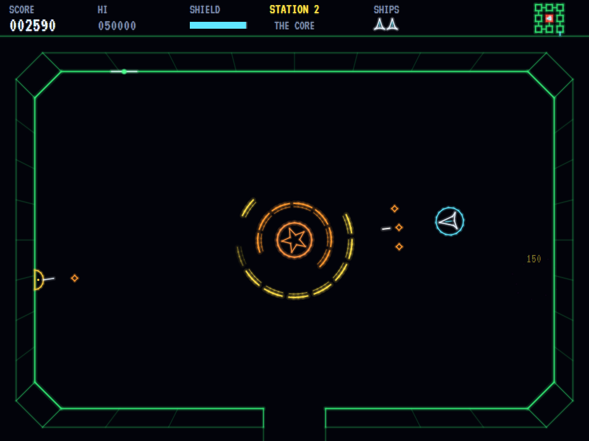
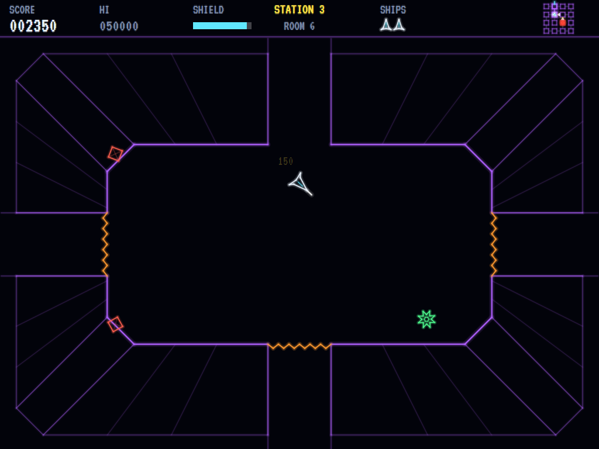
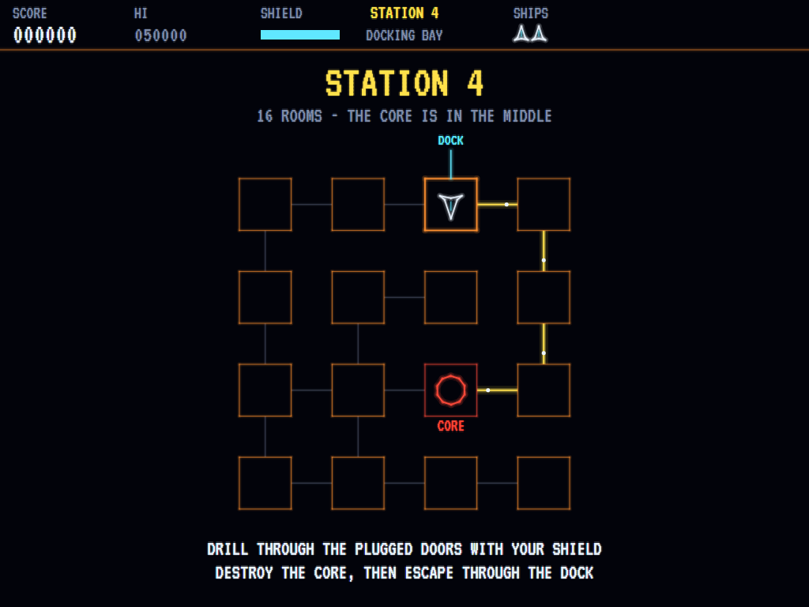
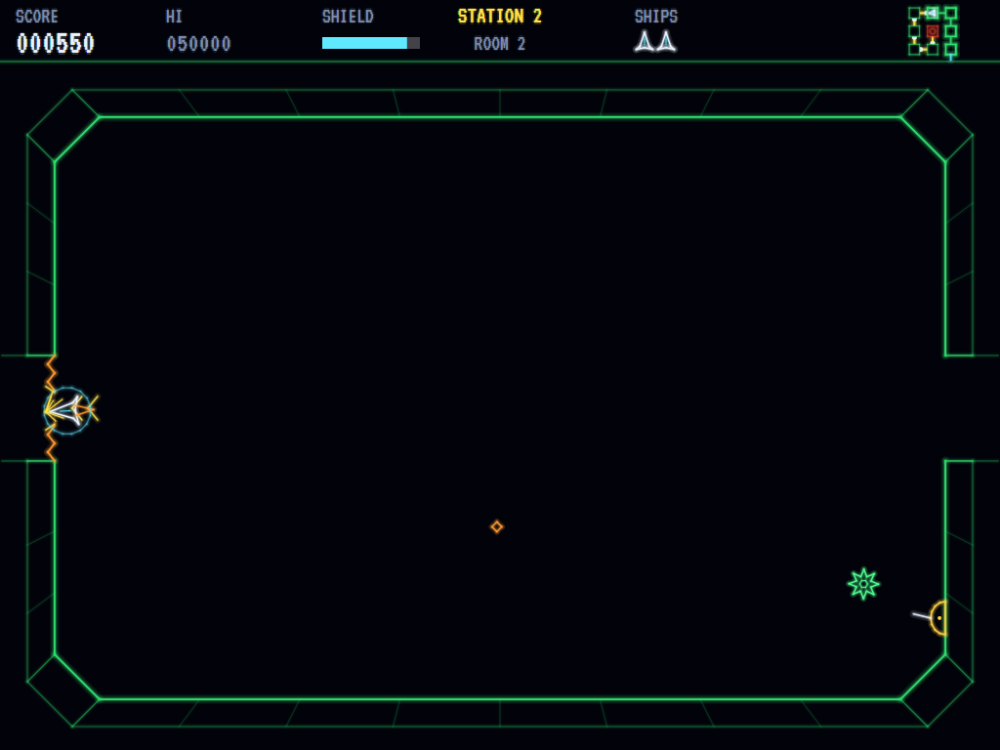

# AVA Cosmic Chasm

[](https://github.com/Harlock123/AVACosmicChasm/actions/workflows/build.yml)

A colour vector shooter in the style of Cinematronics' 1983 arcade game **Cosmic Chasm** (also on the Vectrex),
built with .NET 10 and Avalonia UI. A space station is a network of rooms, with its core in the middle. Fly a
turn-and-thrust ship from the docking bay through room after room, shooting whatever comes out of the walls as
they close in, drill through the plugged doorways with your shield, blast the core through its turning shield
rings, and get back out of the airlock before the station blows. Every station is bigger and faster than the last.

## Features

- **The station map:** each station starts with its plan: the rooms, the doorways between them, the core pulsing
  in the middle, the docking bay on the edge where you come in, and your way to the core picked out in yellow. A
  small copy stays in the corner of the screen, with your ship on it.
- **Rooms that close in:** the walls of every room creep inwards from the moment you arrive, drawn in depth from
  the station's hull like looking down into a chasm. They flash red and the alarm goes as they near each other;
  still be there when they meet and you're crushed. Every room starts wide open again when you come into it.
- **Turn and thrust:** the ship turns, thrusts and drifts on as ships in space do, with just enough drag to be
  brought under control. Touch a wall and it's smashed.
- **The shield is the drill:** raise it and the ship bounces off walls and smashes enemies it touches, and shots
  glance off it, but it can't fire, and it runs down (it charges again when it's lowered). Push it against a
  doorway's armoured plug and the drill bores through, sparks flying, the hole widening from the middle. A
  doorway drilled stays open.
- **Enemies out of the walls:** the walls crack and things push out of them: drifting spores that follow you,
  spinners that swoop round in arcs, crawlers that creep along their wall turning their guns on you, and (from
  the second station) mines that sit still until you come close, then dart. Never out of a doorway, never right
  beside you.
- **The core:** a glowing heart behind two rings of shield plates turning opposite ways. Plates stop your shots
  until they're shot away, then grow back; the core fires spreads back at you, and its field is as hard as a
  wall.
- **The escape:** with the core gone the station starts to self-destruct and the countdown goes up in the score
  bar. Get back to the docking bay (green chevrons point the way) and out of the airlock, which opens at last. In
  time, the station blows apart behind you for a bonus of a thousand a station and a hundred a second to spare.
  Too late, and you go up with it.
- **Stations that grow:** from 3×3 rooms to 5×5, joined in a branching network with short cuts; the walls close
  faster, more comes out of them and it moves faster, the core is tougher, and the drill takes longer.
- **Lives and points:** three ships, an extra one at 10 000 and every 25 000 after; points for every enemy, for
  every new room, every doorway drilled, every shield plate and every hit on the core, and the core itself.
- **Glowing vector lines** with a phosphor halo, every station's walls in their own colour.
- **Keyboard or gamepad.** Sounds made from scratch, and Bach's Toccata in D minor on the title screen.
- **The attract mode** shows the computer pilot at work: it finds its way through the station, lines up with each
  doorway, drills it, picks off what comes out of the walls, shoots its way into the core and runs for the dock.

## Screenshots

| The core | A room closing in |
|:--------:|:-----------------:|
|  |  |
| Shooting through the shield rings. | The walls creeping in from the hull. |

| The station map | Drilling |
|:---------------:|:--------:|
|  |  |
| The way from the dock to the core. | The shield bores through a plug. |

The screenshots are made by the tests, which play the game in a real (headless) window; see [Tests](#tests).

## Download and run

Ready-to-run builds for Windows, macOS and Linux, on both Intel/AMD and ARM, are on the
[Releases page](https://github.com/Harlock123/AVACosmicChasm/releases/tag/latest). **Latest build** is
rebuilt on every push to `main`. Each download is one self-contained executable: no .NET install is
needed.

| Platform | Archive |
|---|---|
| Windows | `AVACosmicChasm-win-x64.zip`, `AVACosmicChasm-win-x86.zip`, `AVACosmicChasm-win-arm64.zip` |
| macOS | `AVACosmicChasm-osx-arm64.tar.gz` (Apple silicon), `AVACosmicChasm-osx-x64.tar.gz` (Intel) |
| Linux | `AVACosmicChasm-linux-x64.tar.gz`, `AVACosmicChasm-linux-arm64.tar.gz`, `AVACosmicChasm-linux-arm.tar.gz` |

```bash
tar -xzf AVACosmicChasm-linux-x64.tar.gz     # or linux-arm64, linux-arm, osx-arm64, osx-x64
./AVACosmicChasm
```

On Windows, unzip and run `AVACosmicChasm.exe`. On macOS, if Gatekeeper refuses to open it, run
`xattr -d com.apple.quarantine AVACosmicChasm` once. Run with `--no-audio` for silence.

**Sound** comes through OpenAL Soft, built in for every platform. In a virtual machine the game
detects it and uses a larger audio buffer, so the sound doesn't break up.

**Gamepads** use SDL2, which is bundled for Windows, macOS and Intel/AMD Linux. ARM Linux builds need it
installed; without it the keyboard still works:

```bash
sudo apt install libsdl2-dev            # Debian / Ubuntu / Raspberry Pi OS
sudo pacman -S --needed sdl2-compat     # Arch / Omarchy
```

## Controls

| Action | Keyboard | Gamepad |
|---|---|---|
| Start | Enter, 1, or fire | Start or A |
| Turn | Left / Right, or A / D | Left stick / D-pad |
| Thrust | Up or W | Stick or D-pad up, B, or right trigger |
| Fire (hold for a stream) | Space, Z or Ctrl | A |
| Shield, and drill (push it into a plug) | Down, S, X or Shift | X, left trigger, or stick down |
| Skip the station map | Fire | A |
| Pause | P or Esc | Start or Back |
| Sound on/off | M | |
| Screenshot | Ctrl+S (to your Pictures folder) | |

On the high-score table, type your initials, or use up/down and Space, then Enter.

## Tests

```bash
dotnet test AVACosmicChasm.slnx
```

The game runs in fixed 60 Hz steps, so it plays the same at any frame rate. The tests check:

- **The stations:** every room can be reached and the core is in the middle; every doorway is shared by the two
  rooms it joins, on facing sides, and starts plugged; stations grow from 3×3 to 5×5; the dock is on the edge,
  its airlock faces out, and it's as far from the core as the passages go; the network branches, often with
  short cuts; the route goes doorway by doorway, the shortest way; the same seed builds the same station.
- **Flying:** right turns clockwise; thrust pushes the way the nose points; let go, it drifts on, slowing a
  little, and never goes faster than its top speed.
- **The walls:** they close in evenly and crush the ship when they meet, shield or no shield; later stations
  close faster and send more; a wall smashes the ship without the shield, and bounces it off with the shield up,
  at a cost in energy; the shield runs out, and charges again when it's lowered.
- **Doorways:** the shield pushed against a plug drills through it in its time, scoring, and the doorway stays
  open from both sides; a plug touched without the shield smashes the ship; a new room starts with its walls
  back and nothing in it, and its first visit scores; the airlock stays shut until the core is gone, and then
  it's the way out.
- **Shooting and enemies:** a shot flies from the nose and destroys what it hits; a crawler takes two; holding
  fire keeps shooting, but only a few shots fly at once and none through the shield; shots stop at the walls;
  enemies come out of the walls but never out of a doorway or beside the ship, up to the station's limit; a
  crawler keeps to its wall and fires at the ship; spores and spinners come after it; running into one smashes
  the ship, but the shield smashes it instead; enemy fire smashes the ship but the shield stops it; just through
  a doorway or back to life, the ship is safe for a moment.
- **The core:** its rings stop shots until plates are shot away, and the plates grow back; a shot through a gap
  in both rings hits the core; destroying it starts the countdown, timed for the rooms between the core and the
  dock; it fires at the ship, and its field is as hard as a wall.
- **The game:** the station map first, then the ship flies, and fire skips the map; a crash costs a ship and it
  comes back where it came in; out of the airlock in time, the station blows, the bonus is paid and the next
  station is bigger; too late, the station goes up with the ship and costs a life; game over, initials, and the
  table kept between games; the title, the demonstration and the high scores; pause; the calls on reaching the
  core and destroying it; the thrust's roar on and off; extra ships; every sound has its file.
- **The computer pilot** destroys the first station and gets out, drills the doorway it needs, and plays the
  demonstration on its own.
- **The controls,** through the input handler: right turns clockwise and left anticlockwise; up thrusts the way
  the ship points; Space, Z and Ctrl fire; down, S, X and Shift raise the shield, and thrust with the shield
  drills a plug; a Shift let go as Caps Lock is let go.

`tests/AVACosmicChasm.Tests/PilotProbe.cs` reports how the computer pilot gets on over whole games, for tuning
(`CHASM_PROBE=1`, or a station number to start there; `CHASM_SEEDS=1,2,3`).

The screenshot tests draw the real screen in a headless window. To refresh the README's pictures:

```bash
CHASM_SHOTS=$PWD/Images dotnet test tests/AVACosmicChasm.Tests --filter ScreenshotTests
```

## Building

```bash
dotnet build AVACosmicChasm.slnx
dotnet run --project src/AVACosmicChasm
```

Needs the .NET 10 SDK. The sounds and the music are made by `tools/make_sounds.py` (standard-library Python):
`python3 tools/make_sounds.py` rewrites `src/AVACosmicChasm/Sounds`.

## Project structure

```
AVACosmicChasm/
├── AVACosmicChasm.slnx
├── src/AVACosmicChasm/
│   ├── Engine/
│   │   ├── GameEngine.cs        # States, the station map, losing a ship, the escape, the next station
│   │   ├── Sim.cs               # The ship, the walls, the drill, doorways, enemies, the core and its rings
│   │   ├── Station.cs           # The rooms and doorways of a station, the dock, and the way through
│   │   ├── World.cs             # The screen's measures, a station's pace, and everything in play
│   │   ├── Pilot.cs             # The computer player (the demonstration, and the tests)
│   │   ├── HighScoreTable.cs, InitialsEntry.cs
│   │   ├── InputHandler.cs, ControllerManager.cs  # Keys and an SDL2 gamepad
│   │   └── SoundManager.cs      # Effects, the thrust and the music through OpenAL
│   ├── Audio/                   # The OpenAL engine (from the author's AVABand)
│   ├── Views/                   # The drawing: glowing vector lines for the rooms, the map and the rest
│   └── Sounds/                  # The synthesised effects and music
├── tests/AVACosmicChasm.Tests/  # Station, gameplay, game, pilot, input and screenshot tests
├── tools/make_sounds.py
└── Images/                      # Screenshots
```

## About and licence

AVA Cosmic Chasm © 2026 Lonnie Watson, under the [MIT License](LICENSE).

*Cosmic Chasm* © 1983 Cinematronics; the name belongs to its current owner. AVA Cosmic Chasm is an independent,
unofficial game in its style. Its stations, enemies, graphics, sounds, music and code are its own; nothing is
taken from the original game's program, graphics or sound. It is not affiliated with or endorsed by any rights
holder.

The title music is the opening of Johann Sebastian Bach's *Toccata and Fugue in D minor*, BWV 565, which is in the
public domain, arranged here for the program's own chip organ; the station, escape and game-over jingles are new
compositions.

The VT323 font is by Peter Hull, under the SIL Open Font License (`src/AVACosmicChasm/Assets/Fonts/VT323-OFL.txt`).
Sound plays through [OpenAL Soft](https://openal-soft.org/) (LGPL; see `src/AVACosmicChasm/Audio/native`) via
Silk.NET, and gamepads through SDL2 via SDL2-CS.
